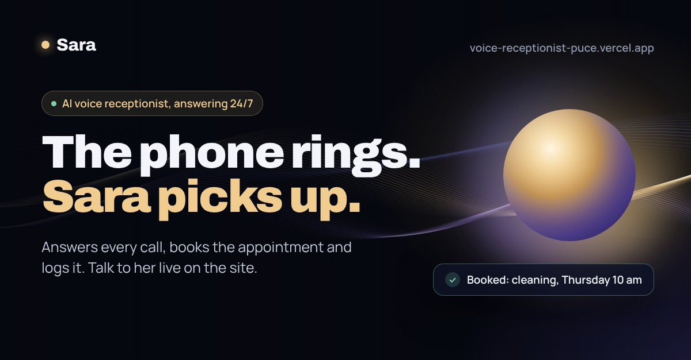
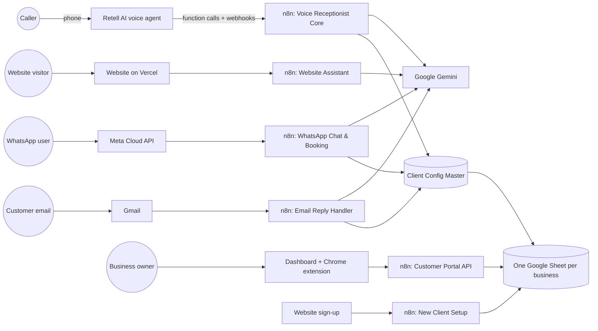
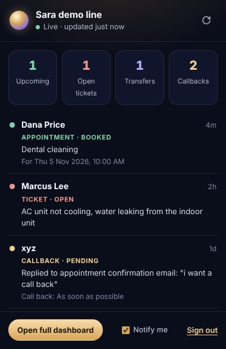

# Sara: AI Voice Receptionist

Sara answers business phone calls 24/7. She books appointments, opens support tickets, transfers callers to the right person, takes callback requests and logs every call for the owner. Customers can also reach her on WhatsApp, by email and on the website by voice or chat, in their own language.

**Try her live:** [voice-receptionist-puce.vercel.app](https://voice-receptionist-puce.vercel.app) · **Call the demo line:** +1 (629) 205-4731

## The problem

Small businesses miss calls after hours, during lunch and when the front desk is busy. Every missed call is a lost booking. A human receptionist costs thousands a month; Sara costs $199 and never sleeps.

## What Sara does

| Channel | What happens |
|---|---|
| **Phone** (Retell AI) | Natural voice conversation. Checks business hours and holidays, answers FAQs, books, reschedules and cancels appointments, opens tickets, transfers to a department, schedules callbacks |
| **WhatsApp** (Meta Cloud API) | Chats with memory, checks and books appointments, sends a confirmation email |
| **Email** | Customers reply to their confirmation email to confirm, cancel or reschedule. Sara reads the reply, updates the booking and answers in the same thread |
| **Website** | Voice and chat assistant that books demo appointments and speaks back with Gemini TTS |
| **Owner dashboard + Chrome extension** | Each business signs in with an emailed 6-digit code and sees only its own appointments, tickets, transfers and callbacks, live |

## Architecture

**Multi-tenant by design.** Every incoming call is matched to a business by the number dialled. The Client Config Master sheet maps each number to that business's own Google Sheet (hours, holidays, FAQs, appointments, tickets, transfers, callbacks and call logs), so one deployment serves many businesses with fully separated data.

## The n8n backend

The full backend is in [`n8n-workflows/`](n8n-workflows), exported and ready to import. Keys, sheet IDs and emails are replaced with placeholders.

| Workflow | Nodes | What it does |
|---|---|---|
| [Voice Receptionist Core](n8n-workflows/01-voice-receptionist-core.json) | 105 | Retell function endpoints: check hours, FAQ answers, book / check / manage appointments, tickets, callbacks, transfers, call logging, confirmation emails |
| [Website Assistant](n8n-workflows/02-website-assistant.json) | 24 | Website voice and chat: Gemini agent with a 4-model fallback chain, demo booking tool, Gemini TTS, per-visitor rate limits |
| [Customer Portal API](n8n-workflows/03-customer-portal-api.json) | 17 | Dashboard and extension backend: email sign-in codes, hashed session tokens, per-business data feed |
| [New Client Setup](n8n-workflows/04-new-client-setup.json) | 18 | Self-serve onboarding: creates the business's sheet, config row and dashboard login, sends the welcome email |
| [WhatsApp Chat & Booking](n8n-workflows/05-whatsapp-chat-booking.json) | 17 | WhatsApp AI agent with memory and Google Sheets booking tools |
| [Email Reply Handler](n8n-workflows/06-email-reply-handler.json) | 18 | Reads replies to confirmation emails, confirms, cancels or reschedules, replies in-thread, notifies the owner |

## Engineering highlights

- **Security:** every Retell endpoint checks an API key; sign-in codes and session tokens are stored only as SHA-256 hashes; login responses are identical whether or not an email has an account, so nobody can probe for customers; a business can only change the status cell of rows in its own sheet.
- **Prompt-injection defence:** every AI agent treats customer messages as conversation, never as instructions, and refuses to reveal its rules or other customers' data.
- **Cost control:** per-visitor hourly and daily limits plus a global daily cap on the website assistant; the voice endpoint only speaks text Sara herself generated, so it can't be abused as a free TTS service; a daily cap on automatic sign-ups flags bot floods.
- **Reliability:** Gemini fallback models and a backup agent, honest fallback replies when every model is out of quota, duplicate-booking checks, and a health monitor that emails the owner when anything breaks.
- **Multilingual:** Sara replies in the caller's language and script (Urdu, Arabic, Spanish, Chinese and more), with right-to-left support on the website.

## Owner dashboard and Chrome extension

- **Dashboard** ([`dashboard.html`](dashboard.html)): passwordless sign-in with an emailed 6-digit code, live feed refreshed every 30 seconds, mark items done.
- **Chrome extension** ([`extension/`](extension)): the same live feed in the browser toolbar, with a badge count and desktop notifications.

## Tech stack

Retell AI · n8n · Google Gemini (chat, structured output, TTS) · Google Sheets API · Gmail API · WhatsApp Business Cloud API · JavaScript (Web Speech and Web Audio APIs) · Chrome Extensions (Manifest V3) · Vercel

## Run it yourself

1. Import the workflows from [`n8n-workflows/`](n8n-workflows) into n8n (see its [README](n8n-workflows/README.md)).
2. Connect your Google Sheets, Gmail, Gemini and WhatsApp credentials.
3. Replace the placeholders (`YOUR_SARA_API_KEY`, `YOUR_CLIENT_CONFIG_MASTER_SHEET_ID`, `YOUR-N8N-INSTANCE`).
4. Point your Retell agent's custom functions at the workflow webhooks.
5. Deploy this repo to Vercel for the website, dashboard and extension download.

## Author

**Muaz Ajmal**, AI Engineer (voice AI agents, workflow automation and LLM-powered robotics)
- LinkedIn: [linkedin.com/in/muaz-ajmal-54318b419](https://www.linkedin.com/in/muaz-ajmal-54318b419)
- Portfolio: [voice-receptionist-puce.vercel.app/muaz-ajmal.html](https://voice-receptionist-puce.vercel.app/muaz-ajmal.html)

Built with AI coding assistance; architecture, n8n backend and testing by Muaz.
